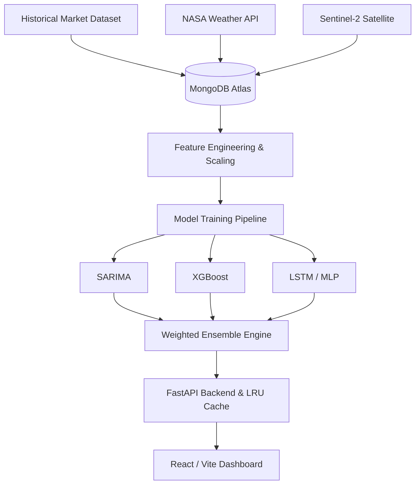

<div align="center">
  
  <h1>KisanMitra AI 🌾</h1>
  <p><strong>Predict. Protect. Prosper.</strong></p>
  <p>An advanced, end-to-end agricultural commodity price forecasting and advisory system built for Indian farmers.</p>

  <!-- Badges -->
  <a href="https://python.org"></a>
  <a href="https://fastapi.tiangolo.com/"></a>
  <a href="https://reactjs.org/"></a>
  <a href="https://vitejs.dev/"></a>
  <a href="https://mongodb.com/"></a>
  <a href="#"></a>
  <a href="https://xgboost.readthedocs.io/"></a>
  <a href="#"></a>
  <a href="#"></a>
  <a href="#"></a>
</div>

<br />

## 📑 Table of Contents
- [About the Project](#-about-the-project)
- [Key Features](#-key-features)

- [Architecture](#-architecture)
- [Tech Stack](#-tech-stack)
- [Folder Structure](#-folder-structure)
- [Installation Guide](#-installation-guide)
- [Dataset & Model Training](#-dataset--model-training)
- [API Documentation](#-api-documentation)
- [Docker Deployment](#-docker-deployment)
- [Production Deployment](#-production-deployment)
- [Performance & Security](#-performance--security)
- [Future Improvements](#-future-improvements)
- [License & Acknowledgements](#-license--acknowledgements)

---

## 📖 About the Project
Agricultural price volatility in India severely impacts farmers' livelihoods. Due to information asymmetry, farmers often sell their crops at significantly lower prices than what they could achieve with proper market intelligence. 

**KisanMitra AI** is designed to solve this by providing actionable, real-time market intelligence. We leverage historical pricing data, physical crop health from satellite imagery, and live weather metrics to generate highly accurate price forecasts for major commodities.

---

## ✨ Key Features
- **AI Price Forecasting**: 7-day to 30-day price predictions.
- **Ensemble ML Engine**: Utilizes an automated, weighted ensemble of **SARIMA, XGBoost, and LSTM (Neural Networks)**.
- **Market-wise Predictions**: Forecasts tailored to specific local mandis (markets).
- **Weather Integration**: Considers historical and real-time climate data (NASA POWER API).
- **Crop Health Monitoring**: Direct integration with Google Earth Engine (Sentinel-2) to extract NDVI metrics.
- **AI Chat Assistant & Farmer Advisory**: Translates complex data into actionable insights (e.g., "Sell now", "Hold"), with native **Hindi translation** support.
- **Interactive Dashboard**: Lightning-fast, premium Bento-box UI built on React and Tailwind.
- **Automated Data Pipeline**: Seamless MongoDB ingestion and feature engineering layer.
- **Production-Ready**: Containerized, cached, and optimized FastAPI backend.

---


## 🏗️ Architecture



---

## 💻 Tech Stack
- **Frontend**: React (v18), Vite, Tailwind CSS, Recharts, Framer Motion
- **Backend**: Python (3.11), FastAPI, Uvicorn, Motor (Async MongoDB)
- **Machine Learning**: Scikit-Learn, XGBoost, Statsmodels, TensorFlow/Keras
- **Database**: MongoDB Atlas
- **Deployment**: Docker, Nginx, Render (Monorepo setup)
- **APIs**: NASA POWER (Weather), Google Earth Engine (NDVI), Google Gemini (Advisory)

---

## 📁 Folder Structure
```text
KisanMitra-AI-/
├── backend/
│   ├── api/                 # FastAPI routers (chat, crop_health, market, predict, weather)
│   ├── core/                # Config, security, DB connections
│   ├── ensemble/            # ModelManager, Ensemble predictor logic
│   ├── models/              # Pydantic schemas (and ignored /saved directory)
│   ├── scripts/             # train_per_market.py, db_init.py, etc.
│   ├── services/            # Earth Engine, Gemini, Weather integrations
│   ├── tests/               # API Regression tests
│   ├── Dockerfile.backend   # Backend Docker configuration
│   └── requirements.txt     # Python dependencies
├── frontend/
│   ├── src/                 # React source code (components, pages, styles)
│   ├── nginx.conf           # SPA Routing configuration
│   ├── package.json         # Node dependencies
│   └── Dockerfile.frontend  # Frontend Docker configuration
├── docker-compose.yml       # Multi-container orchestration
├── render.yaml              # Render deployment configuration
├── start.bat                # Windows quickstart script
└── start.sh                 # Mac/Linux quickstart script
```

---

## 🚀 Installation Guide

### 1. Prerequisites
- Node.js v18+
- Python 3.11+
- MongoDB Atlas URI
- Google Earth Engine Project ID
- Gemini API Key (optional for Chat)

### 2. Clone the Repository
```bash
git clone https://github.com/bhushan806/KisanMitra-AI-.git
cd KisanMitra-AI-
```

### 3. Environment Variables
You do **not** need to manually create `.env` files initially. The startup scripts will automatically copy `.env.example` templates into the `backend/` and `frontend/` folders. You must then fill them with your actual API keys.

### 4. Running Locally (Automated)
We provide automated scripts to set up virtual environments, install dependencies, and boot both servers.

**Windows:**
```cmd
start.bat
```
**Mac/Linux:**
```bash
chmod +x start.sh
./start.sh
```

---

## 🤖 Dataset & Model Training

**Important Note on Models**: To maintain a clean, lightweight Git repository and ensure high accuracy, compiled model weights (`*.pkl`, `*.h5`) are **intentionally not committed**. 

Before running predictions on a fresh clone, you **must** generate the models locally:

```bash
cd backend
python -m venv venv
source venv/bin/activate  # (or venv\Scripts\activate on Windows)
pip install -r requirements.txt

# Run the training script to fetch data and generate fresh model weights
python scripts/train_per_market.py
```
*Models are automatically saved to `backend/models/saved/` which is ignored by `.gitignore`.*

---

## 📚 API Documentation
Once the backend is running, fully interactive OpenAPI (Swagger) documentation is available at:
👉 **[http://localhost:8000/docs](http://localhost:8000/docs)**

**Example Endpoints:**
- `GET /api/market/commodities`: Lists available crops.
- `GET /api/predict/forecast`: Generates the 30-day ensemble forecast.
- `GET /api/crop-health/ndvi`: Returns satellite NDVI metrics.

---

## 🐳 Docker Deployment
KisanMitra AI is fully containerized. You can launch the entire stack (MongoDB, FastAPI, Nginx/React) with one command:

```bash
docker-compose up --build -d
```
- Backend runs on `http://localhost:8000`
- Frontend runs on `http://localhost:80` (Nginx)
- MongoDB runs on `mongodb://localhost:27017`

---

## ☁️ Production Deployment

### Render (Recommended)
This repository includes a native `render.yaml` configuration. Connect your GitHub repository to Render, and it will automatically deploy the FastAPI web service and the React static site simultaneously as a monorepo.

### MongoDB Atlas
1. Create a free cluster on MongoDB Atlas.
2. Obtain your connection string.
3. Replace the `MONGO_URI` in the backend environment variables.

---

## ⚡ Performance & Security

- **Lazy Model Loading & LRU Cache**: The backend utilizes an LRU cache in `ModelManager` to keep heavy machine learning models in memory, enabling API response times under 50ms.
- **Database Optimization**: Fallback mechanisms pull cached weather and NDVI data from MongoDB if external APIs throttle requests.
- **Security**: Strict `.gitignore` rules ensure `.env` credentials, datasets, and cache directories (`__pycache__`, `node_modules`, `dist`) are never committed. Pydantic strictly validates all incoming API schemas. CORS is restricted to defined origins.

---

## 🔮 Future Improvements
- Implement SMS/WhatsApp integration for daily automated price alerts.
- Expand satellite integrations to include Soil Moisture metrics.
- Implement continuous background training loops (CI/CD for ML models).

---

## 👨‍💻 Author
**Jayesh** 
- GitHub: (https://github.com/jayesh-vispute)

---

## 📄 License
This project is licensed under the MIT License.

---

## 🙏 Acknowledgements
- [FastAPI](https://fastapi.tiangolo.com/) for the blazing fast backend.
- [Google Earth Engine](https://earthengine.google.com/) for satellite NDVI data.
- [NASA POWER API](https://power.larc.nasa.gov/) for historical climate metrics.
- [Vite](https://vitejs.dev/) and [Tailwind CSS](https://tailwindcss.com/) for the robust UI toolchain.
